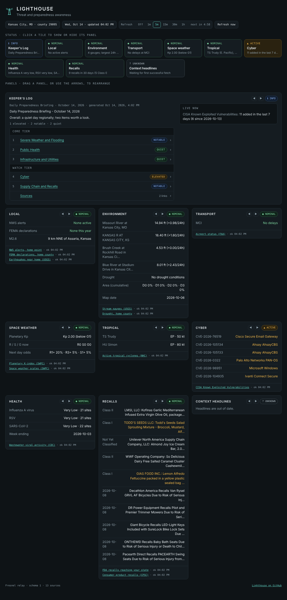

# Lighthouse

A preparedness and threat-awareness board you run yourself. It watches public feeds for your location (weather alerts, earthquakes, floods, drought, tropical storms, space weather, recalls, cyber vulnerabilities, airport delays, wastewater health data, disaster declarations) and shows what needs attention on one page. A daily written briefing from any source you like appears alongside it as the **Keeper's Log**, with each section rated so you can see at a glance what matters.

Nothing is hardcoded to one place. You give it coordinates and it works for any US location. It needs no API keys, no accounts and no database.



## The parts

```
 public feeds (NWS, USGS, FEMA, CISA, NOAA, FAA, CDC, FDA ...)
        │  fetched on a schedule
        ▼
 ┌─────────────────────────────┐        daily brief (optional)
 │  Fresnel — the relay        │◄────── push │ mailbox │ ntfy
 │  fetch · judge · cache      │
 │  serves JSON                │──────► Foghorn: phone alerts through ntfy
 └──────────────┬──────────────┘
                │  GET /v1/snapshot
                ▼
 ┌─────────────────────────────┐
 │  The board                  │   static page; displays what Fresnel decided
 └─────────────────────────────┘
```

| Part | What it is |
|---|---|
| **Fresnel** (`fresnel/`) | The relay. A small Python service that fetches the feeds, decides each one's status, remembers the last good reading, and serves everything as JSON. All logic and all secrets live here. |
| **The board** (`board/`) | A static web page (plain HTML and JavaScript, no build step). It only displays what Fresnel gives it. Serve it from Fresnel or from any web host. |
| **Keeper's Log** | A daily briefing written by something outside Lighthouse (a scheduled job, an AI assistant, a script) and delivered to Fresnel. Fresnel splits it into rated sections. |
| **Foghorn** | Optional phone notifications through [ntfy](https://ntfy.sh) when a source turns active or the brief goes missing. |

The relay and the board are deliberately separate. The board holds no secrets and makes no decisions, so it can sit on a different server than the relay, and a compromised page cannot reach anything private.

## Quick start

On a Linux server with systemd and Python 3.10 or newer (Ubuntu 22.04+, Debian 12+):

```
curl -fsSLO https://raw.githubusercontent.com/ashenroot/Lighthouse/main/install.sh
sudo bash install.sh
```

The installer asks for your coordinates, an optional airport code and a contact email. It then creates a service account, installs Fresnel, writes a config file, starts a `fresnel` service, and prints the next steps. Your county and state are looked up from the coordinates, so there is no code to hunt for.

Check it, then open the board:

```
fresnel check
curl -s http://127.0.0.1:8787/v1/health
```

The board is at `http://127.0.0.1:8787/` on that server. To reach it from your own computer, see [Hosting](docs/hosting.md). For an unattended install, a laptop trial, or a different install location, see [Install](docs/install.md).

Servers with less than about 1 GB of memory should add swap before installing. See [Small servers](docs/install.md#small-servers).

## Documentation

| Guide | What is in it |
|---|---|
| [Install and update](docs/install.md) | Requirements, installer options, manual install, updating, uninstalling, small servers |
| [Configuration](docs/configuration.md) | Every setting in `config.yaml`, with defaults and examples |
| [Sources](docs/sources.md) | Each feed: what it shows, when it turns active, its settings, and what to do when a feed blocks your server |
| [The daily brief](docs/brief.md) | The Keeper's Log: three ways to deliver it, the section and rating format, and a prompt for the job that writes it |
| [Hosting](docs/hosting.md) | Reaching the board from outside: HTTPS, nginx, firewall, a dedicated port, hosting the board separately |
| [Alerts](docs/alerts.md) | Foghorn phone notifications |
| [Commands](docs/cli.md) | Every `fresnel` command |
| [API](docs/api.md) | The JSON the relay serves, and how to push to it |
| [Privacy and security](docs/privacy-security.md) | What leaves your server, what is stored, how secrets are handled |
| [Troubleshooting](docs/troubleshooting.md) | Symptoms and fixes, collected from real installs |

The board itself is described in [`board/README.md`](board/README.md).

## What it reports

| Panel | Feeds | Turns active when |
|---|---|---|
| Local | NWS alerts, FEMA declarations, USGS earthquakes | an alert of moderate or higher severity, a recent declaration for your county, a nearby quake of M4 or more |
| Environment | USGS stream gauges, Drought Monitor | a gauge above flood stage (if you set one), half the county in severe drought |
| Transport | FAA airport status | a delay or ground program at an airport you list |
| Space | NOAA planetary K-index and scales | a geomagnetic storm of G1 or more, a radio blackout of R2 or more, a radiation storm of S1 or more |
| Tropical | National Hurricane Center | a storm in the basin you watch |
| Cyber | CISA Known Exploited Vulnerabilities | new entries in the last day |
| Health | CDC wastewater | half the state's sites at high levels |
| Recalls | FDA and CPSC | a Class I food recall reaching your state |
| Keeper's Log | your daily brief | never; it shows your rated sections |

A source whose data is old, or has never loaded, shows as **unknown** rather than looking fine. Every row links to the publisher's page. All thresholds are settings; see [Sources](docs/sources.md).

## Requirements

- A Linux server (a small VPS is enough), or any machine that can run Python 3.10+
- Outbound HTTPS to the public feeds
- For access from the internet: a domain name and a reverse proxy with a certificate ([Hosting](docs/hosting.md))

## Use it, fork it

Lighthouse is published for anyone to run and adapt, under the [MIT license](LICENSE). It is maintained by one person and is not open to outside pull requests or feature requests; fork it and make it yours.
