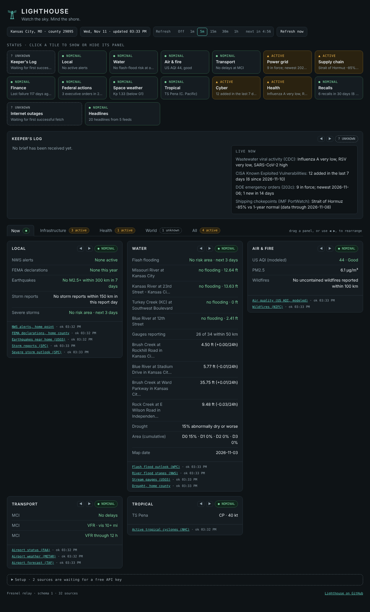

# Lighthouse

A preparedness and threat-awareness board you run yourself. It watches public feeds for your location and shows what needs attention on one page, grouped into tabs: what is happening near you now (weather alerts, storms, floods, air quality, wildfires, airports), the infrastructure around you (power grid, fuel prices, shipping, cyber, space weather), health (hospital load, wastewater, drug shortages, recalls) and the wider world (internet outages, headlines). A daily written briefing from any source you like appears above the tabs as the **Keeper's Log**, with each section rated so you can see at a glance what matters.

Nothing is hardcoded to one place. You give it coordinates and it works for any US location. It needs no accounts and no database, and most of it needs no API keys. A few sources use a free key you enter on the server; without one they wait quietly under a Setup line and everything else works (see [API keys](docs/keys.md)).



## The parts

```
 public feeds (NWS, USGS, FEMA, CISA, NOAA, FAA, CDC, FDA, DOE ...)
        │  fetched on a schedule
        ▼
 ┌─────────────────────────────┐        daily brief (optional)
 │  Fresnel — the relay        │◄────── push │ mailbox │ ntfy
 │  fetch · judge · cache      │
 │  serves JSON                │──────► Foghorn: phone alerts through ntfy
 └──────────────┬──────────────┘
                │  GET /v1/snapshot
                ▼
 ┌─────────────────────────────┐
 │  The board                  │   static page; displays what Fresnel decided
 └─────────────────────────────┘
```

| Part | What it is |
|---|---|
| **Fresnel** (`fresnel/`) | The relay. A small Python service that fetches the feeds, decides each one's status, remembers the last good reading, and serves everything as JSON. All logic and all secrets live here. |
| **The board** (`board/`) | A static web page (plain HTML and JavaScript, no build step). Panels are grouped into tabs, each tab shows how many of its panels are active, and the Keeper's Log stays pinned above them. It only displays what Fresnel gives it. Serve it from Fresnel or from any web host. |
| **Keeper's Log** | A daily briefing written by something outside Lighthouse (a scheduled job, an AI assistant, a script) and delivered to Fresnel. Fresnel splits it into rated sections. |
| **Foghorn** | Optional phone notifications through [ntfy](https://ntfy.sh) when a source turns active or the brief goes missing. |

The relay and the board are deliberately separate. The board holds no secrets and makes no decisions, so it can sit on a different server than the relay, and a compromised page cannot reach anything private. API keys are kept only on the relay's server, in files only the service can read, and never appear in the config, the board or the JSON.

## Quick start

On a Linux server with systemd and Python 3.10 or newer (Ubuntu 22.04+, Debian 12+):

```
curl -fsSLO https://raw.githubusercontent.com/ashenroot/Lighthouse/main/install.sh
sudo bash install.sh
```

The installer asks for your coordinates, an optional airport code and a contact email. It then creates a service account, installs Fresnel, writes a config file, starts a `fresnel` service, and prints the next steps. Your county and state are looked up from the coordinates, so there is no code to hunt for.

Check it, then open the board:

```
fresnel check
curl -s http://127.0.0.1:8787/v1/health
```

The board is at `http://127.0.0.1:8787/` on that server. To reach it from your own computer, see [Hosting](docs/hosting.md). For an unattended install, a laptop trial, or a different install location, see [Install](docs/install.md).

Optional: a few extra sources (EIA fuel prices and grid demand, AirNow air quality) need a free key. Get one from the link the board's Setup line shows, then on the server run `sudo fresnel key set eia` (or `airnow`). Fresnel picks it up within a minute, with no restart. Two settings are worth a look in [Sources](docs/sources.md): `balancing_authority` for the grid demand source, and a `watch` list of drugs for drug shortages.

Servers with less than about 1 GB of memory should add swap before installing. See [Small servers](docs/install.md#small-servers).

## Documentation

| Guide | What is in it |
|---|---|
| [Install and update](docs/install.md) | Requirements, installer options, manual install, updating, uninstalling, small servers |
| [Configuration](docs/configuration.md) | Every setting in `config.yaml`, with defaults and examples |
| [Sources](docs/sources.md) | Each feed: what it shows, when it turns active, its settings, and what to do when a feed blocks your server |
| [The daily brief](docs/brief.md) | The Keeper's Log: three ways to deliver it, the section and rating format, and a prompt for the job that writes it |
| [Hosting](docs/hosting.md) | Reaching the board from outside: HTTPS, nginx, firewall, a dedicated port, hosting the board separately |
| [API keys](docs/keys.md) | The few sources that need a free key: how to set one, where it is kept, what the board shows without one |
| [Alerts](docs/alerts.md) | Foghorn phone notifications |
| [Commands](docs/cli.md) | Every `fresnel` command |
| [API](docs/api.md) | The JSON the relay serves, and how to push to it |
| [Privacy and security](docs/privacy-security.md) | What leaves your server, what is stored, how secrets are handled |
| [Troubleshooting](docs/troubleshooting.md) | Symptoms and fixes, collected from real installs |

The board itself is described in [`board/README.md`](board/README.md).

## What it reports

Each panel belongs to a tab. A tab's badge counts its active panels, and the **All** tab shows every panel. "Free key" marks the sources that need one; the rest work as installed.

### Now

| Panel | Feeds | Turns active when |
|---|---|---|
| Local | NWS alerts, FEMA declarations, USGS earthquakes, SPC storm reports, SPC severe storm outlook | an alert of moderate or higher severity, a recent declaration for your county, a nearby quake of M4 or more, a significant storm report within 150 km, or an enhanced or higher severe-storm outlook for your point in the next three days |
| Water | WPC flash flood outlook, NWS river flood stages, USGS stream gauges (those the river list does not already show), Drought Monitor | a nearby river gauge at minor flooding or worse (observed or forecast), half the county in severe drought, a moderate or higher flash flood outlook |
| Air & fire | air quality (EPA AirNow monitors with a free key, otherwise modeled), NIFC wildfires | US AQI of 101 or more, an uncontained fire of 100+ acres within 100 km |
| Transport | FAA airport status, airport weather (METAR), airport forecast (TAF) | a delay or ground program at an airport you list, IFR or worse weather there, or an IFR or worse forecast for later |
| Tropical | National Hurricane Center | a storm in the basin you watch |

### Infrastructure

| Panel | Feeds | Turns active when |
|---|---|---|
| Power grid | ODIN customer outages, DOE 202(c) emergency orders, NERC alerts, links to regional operators, EIA grid demand (free key) | reported outages reach a threshold in your county or state, a new DOE emergency order (not a plant-retention renewal), demand or its day-ahead forecast within 10% of your grid's one-year peak |
| Supply chain | IMF PortWatch shipping chokepoints, EIA retail gasoline and diesel prices (free key) | a major chokepoint's weekly traffic far below its norm, regional fuel prices up 10% or more over four weeks |
| Finance | FDIC bank failures | a bank failure in the last 14 days |
| Federal actions | Federal Register presidential documents | a new national emergency declaration |
| Cyber | CISA Known Exploited Vulnerabilities | new entries in the last day |
| Space | NOAA planetary K-index and scales | a geomagnetic storm of G1 or more, a radio blackout of R2 or more, a radiation storm of S1 or more |

### Health

| Panel | Feeds | Turns active when |
|---|---|---|
| Health | CDC wastewater, CDC hospital bed occupancy and COVID, flu and RSV patients, FDA drug shortages (every drug on the list, plus an optional watch list) | half the state's wastewater sites at high levels, hospital beds 85% full, a respiratory pathogen's hospital patients up 50% in two weeks, a watched drug short or two new shortage listings in 30 days |
| Recalls | FDA and CPSC | a Class I food recall reaching your state |

### World

| Panel | Feeds | Turns active when |
|---|---|---|
| Internet outages | IODA (Georgia Tech), for the countries you list | a watched country has an internet outage event still running |
| Headlines | RSS feeds you choose (BBC and NPR by default) | never active; a stale feed shows as stale |

The **Keeper's Log** (your daily brief) is pinned above the tabs and is never active; it shows your rated sections.

A source whose data is old, or has never loaded, shows as **unknown** rather than looking fine, and a failed fetch says what failed. Every row links to the publisher's page. All thresholds are settings; see [Sources](docs/sources.md).

Some publishers block requests from cloud and hosting addresses (the FAA airport feed, CISA, FEMA and a few others). When that happens the board shows the failure, and [Sources](docs/sources.md#when-a-feed-blocks-your-server) explains the options.

## Requirements

- A Linux server (a small VPS is enough), or any machine that can run Python 3.10+
- Outbound HTTPS to the public feeds
- For access from the internet: a domain name and a reverse proxy with a certificate ([Hosting](docs/hosting.md))

## Use it, fork it

Lighthouse is published for anyone to run and adapt, under the [MIT license](LICENSE). It is maintained by one person and is not open to outside pull requests or feature requests; fork it and make it yours.
